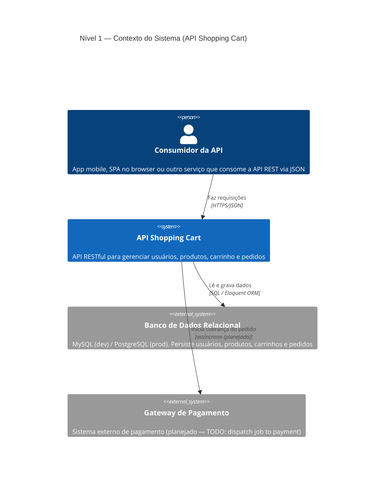
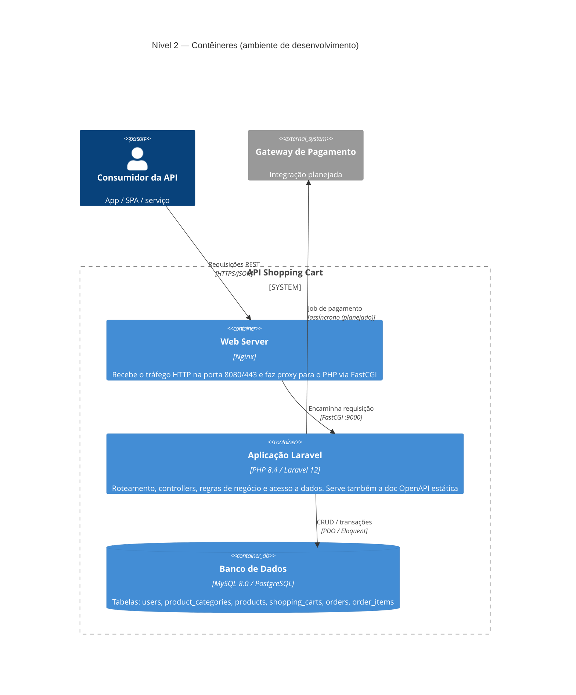
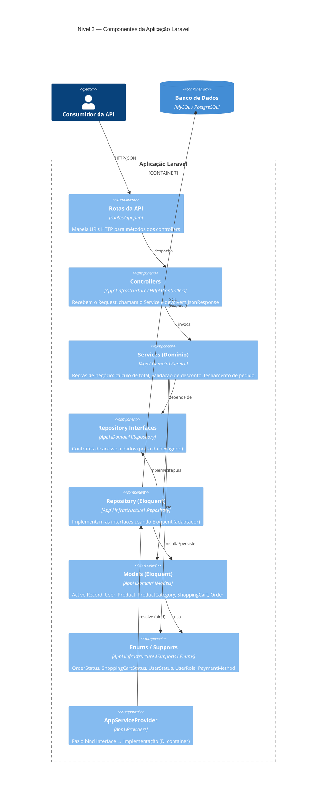
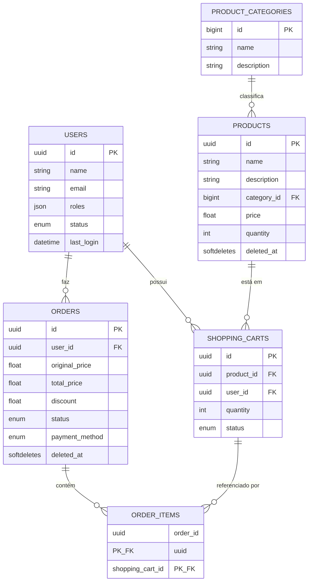
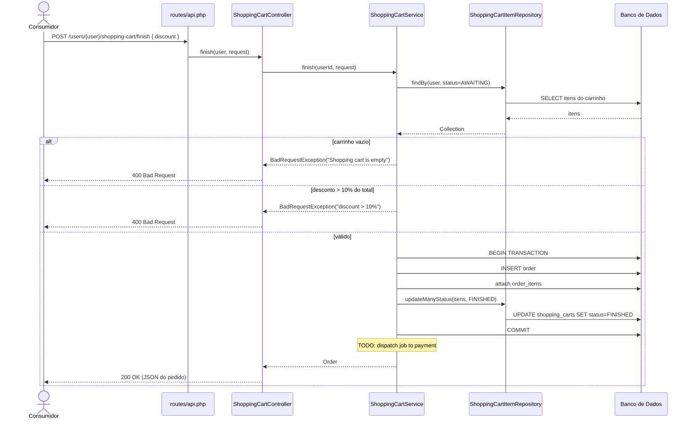

# Documentação Arquitetural — C4 Model

Esta documentação descreve a arquitetura da **API Shopping Cart** seguindo o
[C4 Model](https://c4model.com/) de Simon Brown. O C4 organiza a visão da
arquitetura em quatro níveis de abstração, do mais macro para o mais detalhado:

| Nível | Nome | Pergunta que responde |
|-------|------|-----------------------|
| 1 | **Contexto** (System Context) | Como o sistema se encaixa no mundo? Quem usa e com o que ele conversa? |
| 2 | **Contêineres** (Containers) | Quais são as unidades executáveis/deployáveis e como elas se comunicam? |
| 3 | **Componentes** (Components) | Quais são os blocos lógicos dentro de cada contêiner? |
| 4 | **Código** (Code) | Como os componentes estão estruturados em classes? |

> Os diagramas usam [Mermaid](https://mermaid.js.org/) e são renderizados
> automaticamente pelo GitHub.

---

## Visão geral do sistema

A **API Shopping Cart** é uma API RESTful, escrita em **PHP 8.4 / Laravel 12**,
para gerenciar um carrinho de compras: cadastro de usuários, catálogo de
produtos (com categorias), itens no carrinho e fechamento de pedidos (orders).

A organização interna segue uma interpretação de **Arquitetura Hexagonal / DDD**
em camadas, com separação clara entre `Domain` (regras de negócio) e
`Infrastructure` (entrada/saída e acesso a dados). Veja
[Decisões Técnicas](./TECHNICAL-DECISIONS.md) para o racional original.

---

## Nível 1 — Diagrama de Contexto

Mostra a API como uma caixa preta, seus atores e os sistemas externos.



**Atores e sistemas externos**

- **Consumidor da API** — qualquer cliente HTTP (app mobile, front-end web, CLI,
  outro microsserviço). A camada de apresentação é JSON.
- **Banco de Dados Relacional** — persistência principal. O ambiente Docker de
  desenvolvimento usa **MySQL 8.0** (`docker-compose.yml`); a imagem de produção
  (`Dockerfile` + `railpack.toml`) é configurada para **PostgreSQL**.
- **Gateway de Pagamento** — ainda não implementado. O fluxo de `finish` do
  carrinho deixa marcado um `TODO: dispatch job to payment`, indicando o ponto de
  integração futuro.

---

## Nível 2 — Diagrama de Contêineres

Detalha as unidades deployáveis que compõem o sistema. O ambiente de
desenvolvimento (`docker-compose.yml`) é composto por três contêineres.



**Contêineres**

| Contêiner | Tecnologia | Responsabilidade |
|-----------|------------|------------------|
| **Web Server** | Nginx (`docker/nginx`) | Termina HTTP/HTTPS (portas `8080`/`443`) e encaminha para o PHP via FastCGI. |
| **Aplicação Laravel** | PHP 8.4 / Laravel 12 (`docker/php`) | Núcleo da API: rotas, controllers, services, repositories e models. Também serve a documentação OpenAPI estática em `public/docs/`. |
| **Banco de Dados** | MySQL 8.0 (dev) / PostgreSQL (prod) | Persistência relacional. |

> **Nota de produção:** a imagem do `Dockerfile` empacota a aplicação usando o
> servidor embutido do PHP (`php artisan serve` via `docker/start.sh`) exposto na
> porta `80`, dispensando o Nginx, e utiliza extensões `pdo_pgsql`/`pgsql`.

---

## Nível 3 — Diagrama de Componentes

Faz o "zoom" dentro do contêiner **Aplicação Laravel**, mostrando as camadas
lógicas. O fluxo de uma requisição percorre sempre o mesmo caminho:

`Rotas → Controller → Service → Repository → Model → Banco`



### Camadas (responsabilidades)

- **Rotas** (`routes/api.php`) — declaram os endpoints REST e os agrupam por
  controller/prefixo.
- **Controllers** (`App\Infrastructure\Http\Controllers`) — camada de
  apresentação: traduzem `Request`/`Response` JSON e delegam toda a lógica ao
  Service. Não contêm regras de negócio.
- **Services** (`App\Domain\Service`) — coração do software: validações,
  cálculos (ex.: total do carrinho, limite de 10% de desconto) e orquestração de
  transações (`finish`).
- **Repository Interfaces** (`App\Domain\Repository`) — portas que abstraem o
  acesso a dados; os Services dependem destas, não da implementação.
- **Repositories** (`App\Infrastructure\Repository`) — adaptadores que
  implementam as interfaces usando Eloquent.
- **Models** (`App\Domain\Models`) — entidades Eloquent (padrão Active Record).
- **Enums / Supports** — estados e tipos de domínio.
- **AppServiceProvider** — registra os binds `Interface → Implementação` no
  container de injeção de dependência do Laravel.

### Mapa de endpoints → componentes

| Prefixo | Controller | Service | Operações |
|---------|------------|---------|-----------|
| `/product-categories` | `ProductCategoryController` | `ProductCategoryService` | list, get, create, update, remove |
| `/users` | `UserController` | `UserService` | list, get, create, update, remove |
| `/products` | `ProductController` | `ProductService` | list, get, create, update, remove |
| `/users/{user}/cart-items` | `ShoppingCartItemController` | `ShoppingCartItemService` | list, get, create, update, remove |
| `/users/{user}/shopping-cart` | `ShoppingCartController` | `ShoppingCartService` | get, finish, remove |
| `/users/{user}/orders` | `OrderController` | `OrderService` | list |

---

## Nível 4 — Código

### Estrutura de pastas (mapeamento DDD)

```text
app/
├── Domain/                     # Núcleo de negócio (independente de framework)
│   ├── Models/                 # Entidades Eloquent (User, Product, ...)
│   ├── Repository/             # Interfaces (portas)
│   └── Service/                # Regras de negócio
├── Infrastructure/             # Adaptadores / detalhes técnicos
│   ├── Http/Controllers/       # Camada de apresentação (REST)
│   ├── Repository/             # Implementações Eloquent das portas
│   └── Supports/Enums/         # Enums de domínio
└── Providers/
    └── AppServiceProvider.php  # Bind das interfaces → implementações
```

### Modelo de dados (ERD)

Relacionamentos derivados das migrations em `database/migrations`.



> A tabela `shopping_carts` modela tanto o carrinho quanto cada **item** do
> carrinho (uma linha por produto/quantidade). Ao fechar o pedido, as linhas em
> estado `AWAITING` são vinculadas a um `Order` pela tabela pivô `order_items` e
> têm o status atualizado para `FINISHED`.

### Fluxo dinâmico — fechamento do carrinho (`POST /users/{user}/shopping-cart/finish`)



---

## Referências

- [c4model.com](https://c4model.com/) — definição do C4 Model
- [Decisões Técnicas](./TECHNICAL-DECISIONS.md)
- [Instalação](./INSTALL.md)
- [GitHub Actions](./ACTIONS.md)
- Documentação da API (OpenAPI): `http://localhost:8080/docs/index.html`
